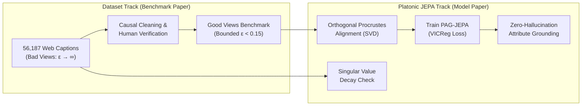

# Companion Project Ecosystem & Data Flow Guide

> **Context Document:** Explains how this repository (`Platonic_JEPA_Track`) interacts with the parent workspace (`FinalYr_Project`), the benchmark pipeline (`Dataset_Track`), and the raw video corpus (`Dataset`).

---

## 1. Master Workspace Layout

When working in the full local research environment, the filesystem is structured as follows:

```
f:\ADI\FinalYr_Project\
├── Dataset\                       <-- Primary Raw Data Store (56,187 video clips)
│   ├── part-1-20261018T051631Z-1-001\
│   ├── part-1-20261018T051631Z-1-002\
│   ├── ... (through 007)\
│   └── data_part1.json           <-- 10.4 MB JSON mapping video_id to raw web caption
│
├── Dataset_Track\                 <-- Paper 1: Benchmark & Curation Pipeline
│   ├── configs/config.yaml       <-- Dataset pipeline configuration
│   ├── outputs/                  <-- Curated metadata, taxonomies & human verification
│   │   ├── manifest.json         <-- 34.2 MB: SHA-256 integrity manifest of all 56,187 videos
│   │   ├── attributes.json       <-- 94.6 MB: Dual LLM consensus extracted attributes
│   │   ├── classes.json          <-- 44.0 MB: Stratification keys & mapped classes
│   │   ├── taxonomy.json         <-- 22.6 KB: Aligned ISCO-08 & Plutchik ontology
│   │   ├── qc.json               <-- 22.6 MB: Automatic multi-detector cleaning cascade
│   │   ├── verification.json     <-- Ground-truth human annotations (3-pass blind protocol)
│   │   └── splits/               <-- 70/15/15 train, val, test splits (leakage audited)
│   ├── stage0_manifest/          <-- PyAV / ffprobe integrity validation
│   ├── stage1_extract/           <-- Dual-LLM (Qwen2.5-7B + Phi-3.5-mini) extraction
│   ├── stage2_taxonomy/          <-- ISCO-08, Plutchik, Leary standard taxonomy alignment
│   ├── stage3_qc/                <-- Decodable, blur, face, and audio cascade
│   ├── stage4_annotation/        <-- Streamlit 3-pass blind human verification application
│   ├── stage5_splits/            <-- Multi-label stratification with maximum entropy
│   ├── stage6_experiments/       <-- Baseline models & AGS evaluation
│   └── stage7_analysis/          <-- Camera-ready LaTeX tables & publication figures
│
├── Platonic_JEPA_Track\           <-- [THIS REPOSITORY] Paper 2: Model Track
│   ├── configs/config.yaml       <-- Config pointing to outputs/ or local caches
│   ├── src/                      <-- PAG-JEPA architecture, VICReg loss, APAD metrics
│   └── scripts/                  <-- Theorem proof scripts & training loops
│
└── ADITHYA_23001\                 <-- Historical Phase: Course Project Archival
    └── AIE23001&AIE23036_CVProject/
        └── Information.txt        <-- ViT + GPT-2 facet training log; identified noisy GT
```

---

## 2. Decoupled Standalone Operation vs. Coupled Mode

This repository is built to work in **two distinct modes**:

### Mode A: Standalone Mode (Cloned on any machine)
- If you clone this repository outside of the main workspace (e.g. on Colab, an external server, or another workstation):
- The codebase uses **cached feature tensors** or the included lightweight synthetic dataset generator (`src/data/mock_generator.py`) to run all SVD spectrum, APAD, and training experiments without requiring the 35 GB of raw video files!

### Mode B: Local Coupled Mode (Inside `FinalYr_Project`)
- When running alongside `Dataset_Track`:
- The configuration in [`configs/config.yaml`](configs/config.yaml) points directly to the companion outputs:
  - `taxonomy_json: "../Dataset_Track/outputs/taxonomy.json"`
  - `verification_json: "../Dataset_Track/outputs/verification.json"`
  - `splits_dir: "../Dataset_Track/outputs/splits"`
  - `dataset_root: "../Dataset"`

---

## 3. Data Flow Between Track 1 and Track 2



1. **Input from Track 1:**
   - **`outputs/verification.json`:** Ground-truth human annotations used to evaluate test-set grounding accuracy without text-prior distortion.
   - **`outputs/taxonomy.json`:** The formal ISCO-08 and Plutchik ontological hierarchy used to construct the Platonic Codebook $\mathcal{C}$.
   - **`outputs/splits/test.json`:** The gold test partition ensuring no leakage from training.
2. **Output of Track 2:**
   - **PAG-JEPA model weights** (`outputs/models/pag_jepa_best.pt`, ~15 MB).
   - **APAD evaluation reports** quantifying how geometric alignment correlates with empirical verifiability rates.
   - Camera-ready figures showing that the Platonic Representation Theorem holds on real video.
