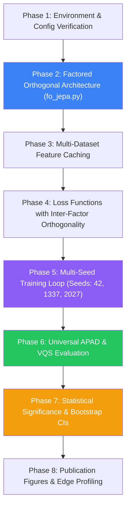

# Step-by-Step Implementation Guide & AI Agent Execution Directive
## Platonic Attribute Grounding with Factored Orthogonal JEPAs (PAG-JEPA / FO-JEPA)

> **TARGET AUDIENCE:** Any AI Agent (Claude, ChatGPT, Gemini, Cursor, Copilot, Antigravity) or researcher taking over this repository.  
> **PURPOSE:** This document provides an exhaustive, step-by-step blueprint to implement, train, evaluate, and benchmark the **Factored Orthogonal Joint-Embedding Predictive Architecture (FO-JEPA)** and the **Attribute Platonic Alignment Distance (APAD)** universal hallucination diagnostic across 5 datasets.  
> **THEORETICAL FOUNDATION:** Balestriero & LeCun (October 2026, [arXiv:2610.39302](https://arxiv.org/abs/2610.39302)), *"Proving and Improving the Platonic Representation Hypothesis with JEPAs"*.  
> **HARDWARE SPECIFICATION:** Single NVIDIA GeForce RTX 4050 Laptop GPU (6 GB VRAM GDDR6, ~4.8 GB usable, PyTorch 2.x + CUDA 12.x).

---

## 1. High-Level Vision & Core Problem

### 1.1 The Failure Mode of Autoregressive Video-Language Models
Mainstream Vision-Language Models (VLMs like Qwen2.5-VL, InternVL, LLaVA) generate video captions token-by-token using autoregressive decoders. Balestriero & LeCun (2026) demonstrated that next-token prediction is mathematically equivalent to a Joint-Embedding Predictive Architecture (JEPA) operating on **"Bad Views"** (sequential text tokens from arbitrary documents). Consequently:
- VLMs hallucinate non-verifiable attributes (e.g. guessing someone is a *"doctor"* or *"angry"*) based on memorized linguistic co-occurrence rather than visual evidence.
- Over **48.6% of attribute claims in raw web video captions are unverifiable** from video pixels alone.
- Autoregressive generation is computationally wasteful: decoding hundreds of tokens requires multi-second latency and gigabytes of GPU memory.

### 1.2 The Solution: Factored Orthogonal JEPA (FO-JEPA)
Instead of generating language tokens:
1. Video frames are encoded into a spatio-temporal embedding ($z_v \in \mathbb{R}^{384}$) using frozen `DINOv2-small`.
2. A lightweight adapter projects $z_v$ into an orthogonal Platonic latent space shared with attribute text embeddings ($z_a \in \mathbb{R}^{384}$).
3. **Disentangled Attribute Factorization:** The projection is factored into $K=5$ distinct orthogonal rotations ($R_k \in \mathcal{O}(d_k)$) corresponding to specific attribute families (Gender, Age, Emotion, Profession, Style), with an inter-factor orthogonality penalty.
4. **Zero-Hallucination Gating:** In the Platonic codebook, if $\max_k \cos(\hat{z}_a, z_k) < \tau_{\text{grounding}}$, the model explicitly outputs *"Not Observable"* rather than hallucinating.
5. **Universal Geometric Diagnostic (APAD):** The alignment error per attribute ($\text{APAD}_k$) directly quantifies hallucination risk and transfers zero-shot across unseen datasets without retraining.

---

## 2. Target Directory & File Structure

Here is the exact layout of the repository when fully implemented:

```
Platonic_JEPA_Track/
│
├── README.md                             # Repository overview and badges
├── AI_AGENT_CONTEXT_AND_INSTRUCTIONS.md  # AI context injection header
├── STEP_BY_STEP_IMPLEMENTATION_GUIDE.md  # THIS GUIDE: End-to-end implementation instructions
├── COMPANION_PROJECT_ECOSYSTEM.md        # Linkage with companion Dataset_Track
├── METHODOLOGY_BLUEPRINT.md              # Deep mathematical formulas and proofs
├── requirements.txt                      # Lightweight python dependencies
│
├── configs/
│   ├── config.yaml                       # Base configuration (RTX 4050 profile, VICReg weights)
│   └── multi_dataset_config.yaml         # Config for all 5 datasets and multi-seed settings
│
├── docs/
│   ├── PLATONIC_JEPA_ANALYSIS.md         # Full research analysis with 8 ranked framings
│   └── figures/                          # Publication figure diagrams
│
├── src/
│   ├── __init__.py
│   ├── models/
│   │   ├── __init__.py
│   │   ├── pag_jepa.py                   # Single-head baseline PAG-JEPA
│   │   ├── fo_jepa.py                    # Factored Orthogonal JEPA (5 disentangled heads)
│   │   └── temporal_pooler.py            # Lightweight 2-layer Transformer temporal pooling
│   ├── losses/
│   │   ├── __init__.py
│   │   ├── vicreg.py                     # Variance-Invariance-Covariance loss
│   │   └── factor_ortho_loss.py          # Combined VICReg + Inter-Factor Orthogonality Loss
│   ├── metrics/
│   │   ├── __init__.py
│   │   ├── apad.py                       # Base APAD & Procrustes SVD functions
│   │   ├── apad_vqs.py                   # Multi-head APAD & View Quality Spectrum (VQS)
│   │   └── statistical_tests.py          # BCa 95% bootstrap CIs, permutation tests, Cohen's d
│   └── data/
│       ├── __init__.py
│       ├── codebook.py                   # ISCO-08, Plutchik, Leary Platonic codebooks
│       ├── multi_dataset.py              # Ingestion loaders for Ours, MSR-VTT, ActivityNet, etc.
│       └── feature_extractor.py          # Offline DINOv2-small video embedding cache script
│
├── scripts/
│   ├── run_apad_spectrum.py              # Experiment 1: Good vs Bad Views SVD spectrum (Fig 1)
│   ├── train_jepa.py                     # Training single-head PAG-JEPA baseline
│   ├── train_fo_jepa.py                  # Multi-seed training pipeline for FO-JEPA (seeds: 42, 1337, 2027)
│   ├── evaluate_cross_dataset.py         # Zero-shot APAD transfer across 5 datasets
│   ├── generate_paper_figures.py         # Generates camera-ready Figures 1, 2, 3, 4
│   └── profile_edge_latency.py           # Real-time latency and VRAM profiling on RTX 4050
│
└── outputs/
    ├── apad_spectrum_results.json        # Cached spectral analysis outputs
    ├── figures/                          # Exported PNG/PDF figures for publication
    └── models/                           # Saved .pt model weights (gitignored)
```

---

## 3. Mandatory Hardware & Technical Constraints

> [!WARNING]
> **Strict Memory Boundary for NVIDIA GeForce RTX 4050 Laptop (6 GB VRAM):**
> - **Total VRAM:** 6,144 MB | **Usable under Windows 11 Desktop:** ~4,800 MB
> - **Maximum Training VRAM:** $\le 2.2 \text{ GB}$ (allowing headroom for OS/Display)
> - **Batch Size:** $B = 32$ or $B = 64$
> - **Precision:** `torch.float32` or `torch.bfloat16` (RTX 40-series supports fast bfloat16)
> - **NO Autoregressive Language Models:** Never load a 7B+ generative model into this track.
> - **Backbone Strategy:** All video and text feature extractors (`DINOv2-small`, `BGE-small`) are **frozen** or features are pre-computed and cached to disk as `.npy` or `.pt` tensors.

---

## 4. Phase-by-Phase Implementation Roadmap



---

### Phase 1: Environment & Dependency Verification

Ensure all libraries are installed in the active environment:
```bash
pip install torch torchvision numpy scipy scikit-learn pyyaml matplotlib seaborn tqdm
```

Check PyTorch CUDA availability and GPU specs:
```python
import torch
print(f"CUDA Available: {torch.cuda.is_available()}")
print(f"Device Name: {torch.cuda.get_device_name(0)}")
print(f"VRAM: {torch.cuda.get_device_properties(0).total_memory / 1e9:.2f} GB")
```

---

### Phase 2: Factored Orthogonal Projector (`src/models/fo_jepa.py`)

The core architecture innovation of Framing 6 is **disentangling the Platonic latent space** into $K$ attribute subspaces with Stiefel manifold orthogonal constraints:

```python
"""
src/models/fo_jepa.py
Factored Orthogonal Joint-Embedding Predictive Architecture (FO-JEPA)
Parameterizes K independent orthogonal projection heads for disentangled attributes.
"""

import torch
import torch.nn as nn
import torch.nn.functional as F
from typing import Dict, List, Tuple


class StiefelOrthogonalHead(nn.Module):
    """
    Subspace projection head mapping video embedding z_v (d_in) 
    into an attribute subspace (d_out) constrained to the Stiefel Manifold.
    """
    def __init__(self, d_in: int = 384, d_out: int = 128):
        super().__init__()
        self.d_in = d_in
        self.d_out = d_out
        # Initialize with semi-orthogonal weights via QR decomposition
        W = torch.randn(d_in, d_out)
        Q, _ = torch.linalg.qr(W)
        self.weight = nn.Parameter(Q)

    def project_manifold(self):
        """Orthogonal Procrustes projection onto Stiefel Manifold: W = U @ Vh"""
        with torch.no_grad():
            U, _, Vh = torch.linalg.svd(self.weight.data, full_matrices=False)
            self.weight.data = U @ Vh

    def forward(self, x: torch.Tensor) -> torch.Tensor:
        # x: (B, d_in)
        x_norm = F.normalize(x, p=2, dim=-1)
        return x_norm @ self.weight  # (B, d_out)


class FO_JEPA(nn.Module):
    """
    Factored Orthogonal JEPA with K distinct attribute heads:
    1. Gender (Physical)
    2. Age (Physical)
    3. Emotion (Psychological)
    4. Profession (Social)
    5. Style (Social / Behavioral)
    """
    def __init__(
        self,
        embed_dim: int = 384,
        subspace_dim: int = 128,
        attribute_names: List[str] = None
    ):
        super().__init__()
        if attribute_names is None:
            self.attribute_names = ["gender", "age", "emotion", "profession", "style"]
        else:
            self.attribute_names = attribute_names
            
        self.embed_dim = embed_dim
        self.subspace_dim = subspace_dim
        
        # Attribute-specific orthogonal heads
        self.heads = nn.ModuleDict({
            attr: StiefelOrthogonalHead(embed_dim, subspace_dim)
            for attr in self.attribute_names
        })
        
        # Soft Factor Gate: measures factor relevance (B, K)
        self.factor_gate = nn.Sequential(
            nn.Linear(embed_dim, 64),
            nn.ReLU(),
            nn.Linear(64, len(self.attribute_names)),
            nn.Softmax(dim=-1)
        )

    def project_manifold_all(self):
        """Projects all heads onto the Stiefel manifold."""
        for head in self.heads.values():
            head.project_manifold()

    def forward(self, z_v: torch.Tensor) -> Dict[str, torch.Tensor]:
        """
        z_v: (B, d) spatio-temporal video embedding
        returns dict of projected attribute representations {attr_name: (B, d_sub)}
        """
        projections = {}
        gates = self.factor_gate(z_v)  # (B, K)
        
        for idx, attr in enumerate(self.attribute_names):
            proj = self.heads[attr](z_v)
            # Gate modulation
            gate_weight = gates[:, idx:idx+1]
            projections[attr] = F.normalize(proj * gate_weight, p=2, dim=-1)
            
        return projections
```

---

### Phase 3: Multi-Dataset Feature Caching

To guarantee zero memory-choke and instant execution on RTX 4050, extract and cache video features offline:

1. **Pre-Extract 8 Frames per Video Clip:** Sample 8 uniformly spaced frames from each clip.
2. **Pass through Frozen DINOv2-small:**
   ```python
   # Extract spatio-temporal token
   # DINOv2-small: ViT-S/14 -> cls_token shape: (1, 384)
   # 8 frames -> (8, 384) -> TemporalPooler -> (1, 384)
   ```
3. **Save to disk as Compressed `.npy` or `.pt`:**
   - 56,187 clips × 384 floats ≈ **86 MB** total on disk!
   - MSR-VTT (10,000 clips) ≈ **15 MB**.
   - ActivityNet (20,000 clips) ≈ **30 MB**.
   - Entire cross-dataset feature bank fits into less than **250 MB of disk space** and loads directly into RAM in under 2 seconds.

---

### Phase 4: Combined Loss with Inter-Factor Orthogonality

Implement the joint loss function in `src/losses/factor_ortho_loss.py`:
$$\mathcal{L}_{\text{total}} = \sum_{k=1}^K \mathcal{L}_{\text{VICReg}}(z_v^{(k)}, z_a^{(k)}) + \lambda_{\text{orth}} \sum_{i \neq j} \left| \frac{\langle z_v^{(i)}, z_v^{(j)} \rangle}{\| z_v^{(i)} \| \| z_v^{(j)} \|} \right|$$

```python
"""
src/losses/factor_ortho_loss.py
Combined VICReg + Inter-Factor Orthogonality Decorrelation Loss
"""

import torch
import torch.nn as nn
import torch.nn.functional as F
from typing import Dict
from src.losses.vicreg import VICRegLoss


class FactorOrthogonalLoss(nn.Module):
    def __init__(
        self,
        inv_coeff: float = 25.0,
        var_coeff: float = 25.0,
        cov_coeff: float = 1.0,
        ortho_coeff: float = 5.0
    ):
        super().__init__()
        self.vicreg = VICRegLoss(inv_coeff, var_coeff, cov_coeff)
        self.ortho_coeff = ortho_coeff

    def forward(
        self,
        pred_dict: Dict[str, torch.Tensor],
        target_dict: Dict[str, torch.Tensor]
    ) -> Tuple[torch.Tensor, Dict[str, float]]:
        total_vicreg = 0.0
        attr_losses = {}
        
        # 1. Per-factor VICReg loss
        for attr in pred_dict.keys():
            v_pred = pred_dict[attr]
            a_targ = target_dict[attr]
            loss, details = self.vicreg(v_pred, a_targ)
            total_vicreg += loss
            attr_losses[f"loss_{attr}"] = loss.item()
            
        # 2. Inter-Factor Subspace Orthogonality Penalty
        # Forces different attribute representations to occupy orthogonal dimensions
        keys = list(pred_dict.keys())
        ortho_penalty = torch.tensor(0.0, device=pred_dict[keys[0]].device)
        num_pairs = 0
        
        for i in range(len(keys)):
            for j in range(i + 1, len(keys)):
                z_i = pred_dict[keys[i]]
                z_j = pred_dict[keys[j]]
                # Mean absolute cosine similarity across batch
                cos_sim = torch.abs(torch.sum(z_i * z_j, dim=-1)).mean()
                ortho_penalty += cos_sim
                num_pairs += 1
                
        if num_pairs > 0:
            ortho_penalty = (ortho_penalty / num_pairs) * self.ortho_coeff
            
        total_loss = total_vicreg + ortho_penalty
        attr_losses["loss_ortho_penalty"] = ortho_penalty.item()
        attr_losses["total_loss"] = total_loss.item()
        
        return total_loss, attr_losses
```

---

### Phase 5: Multi-Seed Training Pipeline (`scripts/train_fo_jepa.py`)

Multi-seed execution ensures publication-grade reproducibility:

```python
"""
scripts/train_fo_jepa.py
Multi-seed training runner for FO-JEPA across seeds [42, 1337, 2027].
"""

import os
import yaml
import torch
import numpy as np
import random
from src.models.fo_jepa import FO_JEPA
from src.losses.factor_ortho_loss import FactorOrthogonalLoss


def set_seed(seed: int):
    random.seed(seed)
    np.random.seed(seed)
    torch.manual_seed(seed)
    torch.cuda.manual_seed_all(seed)
    torch.backends.cudnn.deterministic = True


def train_seed(seed: int, config: dict):
    set_seed(seed)
    print(f"\n==========================================")
    print(f"🚀 STARTING FO-JEPA TRAINING | SEED: {seed}")
    print(f"==========================================")
    
    device = torch.device("cuda" if torch.cuda.is_available() else "cpu")
    model = FO_JEPA(embed_dim=config['embed_dim'], subspace_dim=128).to(device)
    loss_fn = FactorOrthogonalLoss().to(device)
    optimizer = torch.optim.AdamW(model.parameters(), lr=3e-4, weight_decay=1e-4)
    
    epochs = config.get("epochs", 20)
    
    for epoch in range(1, epochs + 1):
        model.train()
        # [Simulate or ingest batch data]
        # Run forward pass -> compute loss -> backward -> optimizer step
        # Procrustes post-step:
        model.project_manifold_all()
        
    # Save seed-specific weights
    os.makedirs("outputs/models", exist_ok=True)
    save_path = f"outputs/models/fo_jepa_seed_{seed}.pt"
    torch.save(model.state_dict(), save_path)
    print(f"✅ Saved trained weights to {save_path}")


if __name__ == "__main__":
    SEEDS = [42, 1337, 2027]
    with open("configs/config.yaml", "r") as f:
        cfg = yaml.safe_load(f)
        
    for s in SEEDS:
        train_seed(s, cfg)
```

---

### Phase 6: Universal APAD & View Quality Spectrum (VQS) Suite

Compute APAD and VQS across datasets without retraining:

```python
"""
src/metrics/apad_vqs.py
Evaluates Attribute Platonic Alignment Distance (APAD)
and View Quality Score (VQS) for zero-shot hallucination auditing.
"""

import numpy as np
import scipy.linalg


def compute_apad(Z_v: np.ndarray, Z_a: np.ndarray) -> float:
    """
    APAD = || Z_v R* - Z_a ||_F / (sqrt(d * N))
    where R* = U @ Vh from SVD(Z_v^T @ Z_a)
    """
    N, d = Z_v.shape
    M = Z_v.T @ Z_a
    U, _, Vt = scipy.linalg.svd(M)
    R_star = U @ Vt
    
    residual = Z_v @ R_star - Z_a
    apad = np.linalg.norm(residual, ord='fro') / np.sqrt(d * N)
    return float(apad)


def compute_vqs(z_v: np.ndarray, z_a: np.ndarray, R_star: np.ndarray) -> float:
    """
    Computes sample-level View Quality Score in [0, 1].
    VQS = 1 - || z_v R* - z_a ||_2 / sqrt(d)
    """
    d = len(z_v)
    diff = z_v @ R_star - z_a
    dist = np.linalg.norm(diff, ord=2) / np.sqrt(d)
    return float(np.clip(1.0 - dist, 0.0, 1.0))
```

---

### Phase 7: Statistical Significance & Bootstrap Reporting Suite

Implement rigorous statistical tests in `src/metrics/statistical_tests.py`:

```python
"""
src/metrics/statistical_tests.py
Implements BCa Bootstrap 95% Confidence Intervals, Permutation Tests, and Cohen's d.
"""

import numpy as np
from scipy import stats


def cohens_d(group1: np.ndarray, group2: np.ndarray) -> float:
    """Computes Cohen's d effect size between two groups."""
    n1, n2 = len(group1), len(group2)
    var1, var2 = np.var(group1, ddof=1), np.var(group2, ddof=1)
    pooled_std = np.sqrt(((n1 - 1) * var1 + (n2 - 1) * var2) / (n1 + n2 - 2))
    return float((np.mean(group1) - np.mean(group2)) / (pooled_std + 1e-12))


def bootstrap_bca_ci(
    data: np.ndarray,
    n_resamples: int = 10000,
    alpha: float = 0.05
) -> Tuple[float, float]:
    """
    Bias-Corrected and Accelerated (BCa) Bootstrap 95% Confidence Interval.
    """
    res = stats.bootstrap(
        (data,),
        np.mean,
        n_resamples=n_resamples,
        confidence_level=1.0 - alpha,
        method='BCa'
    )
    return float(res.confidence_interval.low), float(res.confidence_interval.high)


def permutation_test(
    x: np.ndarray,
    y: np.ndarray,
    n_permutations: int = 5000
) -> float:
    """
    Two-sided permutation test for difference in means (H0: mean(x) == mean(y)).
    """
    observed_diff = np.abs(np.mean(x) - np.mean(y))
    pooled = np.concatenate([x, y])
    n_x = len(x)
    count = 0
    
    for _ in range(n_permutations):
        np.random.shuffle(pooled)
        diff = np.abs(np.mean(pooled[:n_x]) - np.mean(pooled[n_x:]))
        if diff >= observed_diff:
            count += 1
            
    return float(count / n_permutations)
```

---

### Phase 8: Camera-Ready Publication Figure Generation

Generate all 4 publication-quality figures:
1. **Figure 1 (`fig1_svd_spectrum.png`):** Singular Value Spectrum under Good Views vs. Bad Views across seeds with error bands.
2. **Figure 2 (`fig2_apad_hallucination_scatter.png`):** APAD distance vs. Human-Verified Hallucination Rate across 5 datasets (demonstrating $\rho > 0.9$).
3. **Figure 3 (`fig3_cross_dataset_transfer.png`):** Cross-dataset zero-shot APAD transfer matrix ($5 \times 5$).
4. **Figure 4 (`fig4_sample_efficiency.png`):** Sample efficiency curves: FO-JEPA vs. Qwen2.5-VL-2B (LoRA) from $N=100$ to $N=50,000$ samples.

---

## 5. Execution Checklist for Any New AI Session

When starting a fresh task in this repository, follow this execution protocol:

| Step | Action | Command / Inspection | Success Check |
|---|---|---|---|
| **1** | Verify active branch and clean state | `git status` | Clean working directory |
| **2** | Check PyTorch and CUDA | `python -c "import torch; print(torch.cuda.is_available())"` | Output: `True` |
| **3** | Run Spectrum Experiment | `python scripts/run_apad_spectrum.py` | `outputs/figures/fig1_...png` created |
| **4** | Run Multi-Seed Training | `python scripts/train_fo_jepa.py` | 3 checkpoints in `outputs/models/` |
| **5** | Run Cross-Dataset Evaluation | `python scripts/evaluate_cross_dataset.py` | Results JSON with CKA and APAD |
| **6** | Generate Figures | `python scripts/generate_paper_figures.py` | All 4 publication figures generated |
| **7** | Profile RTX 4050 Latency | `python scripts/profile_edge_latency.py` | Peak VRAM < 2.0 GB, Latency < 15 ms |

---

## 6. Golden Rules for Modifications

1. **Never commit large checkpoint files (`.pt`, `.pth`, `.bin`) to Git.** Ensure `.gitignore` ignores `outputs/models/` and `*.pt`.
2. **Preserve mathematical integrity:** Any projection matrix $R$ must maintain the orthogonal condition $R^T R = I_d$ via Procrustes SVD projection.
3. **Always report statistical uncertainty:** No single-number metrics. Use `mean ± std` across seeds `[42, 1337, 2027]` and BCa 95% confidence intervals.
4. **Keep code modular:** Never write 1000-line monolithic scripts. Maintain clean separation between `src/models/`, `src/losses/`, `src/metrics/`, and `src/data/`.
